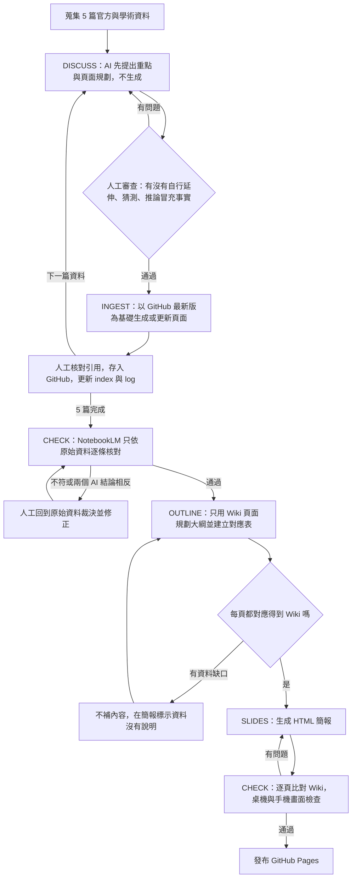

# 手部衛生 LLM Wiki

> 給第一次陪病家屬的手部衛生知識庫，並以此製作教學 HTML 簡報。

- **Wiki（本 repo）**：https://github.com/EllenHuangD/hand-hygiene-wiki
- **教學 HTML 簡報**：https://ellenhuangd.github.io/hand-hygiene-wiki/slides/

---

## 1. 主題與簡介

我想做一個醫療護理相關、又能讓一般人馬上用得上的主題，最後選了「手部衛生」。家人住院時，陪病的家屬常常是第一次待在病房，不太清楚什麼時候要洗手，也容易以為戴了手套就夠了。所以我用 5 份官方與學術資料建立這個 Wiki，整理「為什麼洗、何時洗、怎麼洗」，再用它做一份給陪病家屬看的教學簡報。

| 編號 | 資料 | 類型 |
|---|---|---|
| S1 | 衛福部疾管署 2026 世界手部衛生日新聞稿 | 中文新聞稿 |
| S2 | 衛福部疾管署 2025 世界手部衛生日新聞稿（手套） | 中文新聞稿 |
| S3 | WHO〈Five moments for hand hygiene〉海報 | 英文圖片式 PDF |
| S4 | 衛福部 2020 世界手部衛生日新聞稿（五步驟、七字訣） | 中文新聞稿 |
| S5 | Sax et al. (2007) 'My five moments for hand hygiene' 摘要 | 英文學術文獻 |

## 2. Wiki 結構

| 路徑 | 說明 |
|---|---|
| `raw/` | 原始資料（不修改），清單見 `raw/sources.md` |
| `wiki/index.md` | Wiki 目錄 |
| `wiki/sources/` | S1–S5 摘要頁 |
| `wiki/concepts/` | 5 個概念頁：手部衛生、照顧者洗手5時機、民眾洗手5時機、洗手7步驟、戴手套與手部衛生 |
| `wiki/log.md` | **執行與檢查紀錄**（每次討論、生成、檢查、修正都有記錄） |
| `rules.md` | 給 AI 的維護規則（執行中新增了第 7、8 條） |
| `mapping.md` | 簡報頁 ↔ Wiki 頁 ↔ 來源 對應表 |
| `slides/index.html` | 教學 HTML 簡報 |

**工具（皆免費）**：Gemini（討論與生成）、NotebookLM（只依原始資料檢查）、Claude（簡報生成）、GitHub Pages（發布）

## 3. Loop / Graph 設計

**會重複執行的步驟**
- DISCUSS → INGEST：每篇資料跑一次（S4、S5 合併處理，共 4 輪）
- DISCUSS 審查不通過就重新討論；NotebookLM 檢查不通過就修正後再檢查；簡報檢查不通過就重新生成

**需要檢查或重新生成的地方**
1. 生成前：人工審查 AI 的規劃（最常抓到錯誤的地方）
2. 生成後：人工核對引用是否標對來源
3. 全部完成後：用**另一個工具** NotebookLM 只依原始資料交叉檢查
4. 簡報：逐頁比對 Wiki，避免加入 Wiki 沒有的內容

**為什麼這樣設計**
- **生成和檢查用不同工具**：我用 Gemini 寫內容、用 NotebookLM 檢查。如果讓同一個 AI 檢查自己寫的東西，它很可能看不出自己的錯。
- **先討論、再生成**：先讓 AI 說它打算怎麼寫，我確認沒問題才讓它寫。在這個階段改方向，比整頁寫完再一句句修正輕鬆很多。
- **簡報只能用 Wiki，不能直接讀原始資料**：Wiki 的內容都檢查過了，簡報只從 Wiki 取材，每一頁都能透過 mapping.md 找到出處。
- **醫療主題寧可少寫，也不能寫錯**：資料沒寫的地方就標 ⚠，不讓 AI 用常識補上。簡報上也直接告訴家屬「資料沒有說明，請問醫護人員」。

## 4. 實際執行與檢查紀錄

完整紀錄見 [wiki/log.md](wiki/log.md)，摘要如下：

| 類型 | 次數 | 例子 |
|---|---|---|
| AI 自行延伸 | 3 | 「看病前後」被寫成「進出醫院」；「搭乘大眾運輸」被寫成「包含陪病往返途中」；簡報加入「陪家人看病也算」 |
| AI 猜測或推論冒充事實 | 3 | 自行解釋「暴觸」；聲稱海報「證實」暴觸＝EXPOSURE；「台灣擴大適用」推論標上來源 |
| 引用標錯來源 | 4 | S2 的「全球十大健康威脅」被標 [S3]；海報「SAVE LIVES」被混淆成 2026 主題 |
| AI 覆蓋人工修正 | 1 | GitHub 上修正過的段落被 Gemini 用舊版本改回去 |
| 查證後確認正確 | 3 | 「2025 年」「2020 年」確實出自原文 |
| 兩個 AI 結論相反 | 1 | 海報上有沒有細菌圖示：人工檢視 PDF 裁決 |
| NotebookLM 總檢查 | 20 條 | 18 條通過，1 條衝突經人工裁決，1 條反向檢查確認 ⚠ 標示正確 |

## 5. 反思

**哪一個節點最常出錯？**
最常出錯的是 AI 讀資料、寫摘要的節點（DISCUSS／INGEST）。一開始我以為 AI 出錯會是亂寫，實際做了才發現，它的錯誤多半是「看起來很合理地多寫一點」。例如原文只寫「看病前後」，它寫成「進出醫院」；原文用「暴觸」，它自己解釋成「暴露、接觸」。這些內容乍看都沒問題，不回頭對照原文根本看不出來。

最讓我意外的是 S3 那張 WHO 海報。海報上的字大多是圖片，Gemini 說病床周圍畫了細菌，NotebookLM 卻說沒有。兩個 AI 說法相反，最後是我自己把 PDF 放大來看，才確定 Gemini 是對的。這讓我知道，連負責檢查的 AI 也會出錯，圖片內容一定要有人親眼確認。

**發現問題後，把檢查往前移到哪一步？**
1. **從「生成後檢查」移到「生成前的討論」**：每篇資料都先讓 AI 說明它打算寫什麼，我在這個階段就抓出「進出醫院」這類延伸，不必等整頁寫完再改。
2. **處理圖片資料時，再往前加一步**：讓 AI 先逐字列出它從 PDF 讀到哪些字，讀不清楚的要標「無法辨識」，我再打開 PDF 對照。這樣就能分辨哪些是它真的讀到的、哪些是憑印象補的。
3. **做簡報前先檢查大綱**：確認每一頁都對應得到 Wiki 頁面。資料不足的地方，在大綱階段就決定「標示出來，不補充」。

**有沒有因此修改 workflow？為什麼？**
有，我改了兩次，都寫進 rules.md：
- **第 7 條，更新前先給 AI 最新版**：處理 S3 時，我發現 S2 階段在 GitHub 上修好的段落又被改回去了。原因是 Gemini 不知道我在 GitHub 上改過，它是拿自己記得的舊版本來更新。所以從 S4 開始，我先把 GitHub 上的最新版貼給它，之後就沒有再發生。
- **第 8 條，推論要標「整理者觀察」**：處理 S5 時，AI 寫了一句很有道理的結論，卻把三份資料都標成來源，但其實沒有任何一份資料這樣寫。我改成這類內容一律標「整理者觀察」、不標引用，讓讀者分得出哪些是資料寫的、哪些是整理出來的。

整個過程比我想像中繁瑣，每篇資料都要討論、生成、檢查、修正。但也正因為一步步記錄下來，我才看得出錯誤集中在哪裡，知道該把檢查放在哪個位置。
