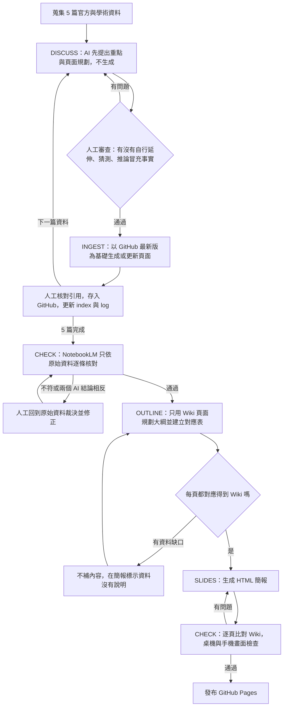

# 手部衛生 LLM Wiki

> 給第一次陪病家屬的手部衛生知識庫，並以此製作教學 HTML 簡報。

- **Wiki（本 repo）**：https://github.com/EllenHuangD/hand-hygiene-wiki
- **教學 HTML 簡報**：https://ellenhuangd.github.io/hand-hygiene-wiki/slides/

---

## 1. 主題與簡介

（✏️ 請改成自己的話）第一次到醫院陪病的家屬，常常不知道什麼時候該洗手、戴手套是否就夠了。這個 Wiki 以 5 份官方與學術資料為基礎，整理「為什麼洗、何時洗、怎麼洗」，再用它製作一份給家屬看的教學簡報。

| 編號 | 資料 | 類型 |
|---|---|---|
| S1 | 衛福部疾管署 2026 世界手部衛生日新聞稿 | 中文新聞稿 |
| S2 | 衛福部疾管署 2025 世界手部衛生日新聞稿（手套） | 中文新聞稿 |
| S3 | WHO〈Five moments for hand hygiene〉海報 | 英文圖片式 PDF |
| S4 | 衛福部 2020 世界手部衛生日新聞稿（五步驟、七字訣） | 中文新聞稿 |
| S5 | Sax et al. (2007) 'My five moments for hand hygiene' 摘要 | 英文學術文獻 |

## 2. Wiki 結構

| 路徑 | 說明 |
|---|---|
| `raw/` | 原始資料（不修改），清單見 `raw/sources.md` |
| `wiki/index.md` | Wiki 目錄 |
| `wiki/sources/` | S1–S5 摘要頁 |
| `wiki/concepts/` | 5 個概念頁：手部衛生、照顧者洗手5時機、民眾洗手5時機、洗手7步驟、戴手套與手部衛生 |
| `wiki/log.md` | **執行與檢查紀錄**（每次討論、生成、檢查、修正都有記錄） |
| `rules.md` | 給 AI 的維護規則（執行中新增了第 7、8 條） |
| `mapping.md` | 簡報頁 ↔ Wiki 頁 ↔ 來源 對應表 |
| `slides/index.html` | 教學 HTML 簡報 |

**工具（皆免費）**：Gemini（討論與生成）、NotebookLM（只依原始資料檢查）、Claude（簡報生成）、GitHub Pages（發布）

## 3. Loop / Graph 設計

**會重複執行的步驟**
- DISCUSS → INGEST：每篇資料跑一次（S4、S5 合併處理，共 4 輪）
- DISCUSS 審查不通過就重新討論；NotebookLM 檢查不通過就修正後再檢查；簡報檢查不通過就重新生成

**需要檢查或重新生成的地方**
1. 生成前：人工審查 AI 的規劃（最常抓到錯誤的地方）
2. 生成後：人工核對引用是否標對來源
3. 全部完成後：用**另一個工具** NotebookLM 只依原始資料交叉檢查
4. 簡報：逐頁比對 Wiki，避免加入 Wiki 沒有的內容

**為什麼這樣設計**（✏️ 請改成自己的話）
- **生成與檢查分開**：Gemini 生成、NotebookLM 檢查，避免同一個 AI 檢查自己的答案。
- **先討論、後生成**：錯誤在「規劃」階段就修正，比生成完再改省事。
- **簡報只能用 Wiki，不能直接讀原始資料**：確保簡報內容都經過檢查，且能用 mapping.md 追溯。
- **醫療主題寧缺勿濫**：資料沒寫的就標 ⚠，不讓 AI 用常識補，簡報上也明白告訴讀者「資料沒有說明」。

## 4. 實際執行與檢查紀錄

完整紀錄見 [wiki/log.md](wiki/log.md)，摘要如下：

| 類型 | 次數 | 例子 |
|---|---|---|
| AI 自行延伸 | 3 | 「看病前後」被寫成「進出醫院」；「搭乘大眾運輸」被寫成「包含陪病往返途中」；簡報加入「陪家人看病也算」 |
| AI 猜測或推論冒充事實 | 3 | 自行解釋「暴觸」；聲稱海報「證實」暴觸＝EXPOSURE；「台灣擴大適用」推論標上來源 |
| 引用標錯來源 | 4 | S2 的「全球十大健康威脅」被標 [S3]；海報「SAVE LIVES」被混淆成 2026 主題 |
| AI 覆蓋人工修正 | 1 | GitHub 上修正過的段落被 Gemini 用舊版本改回去 |
| 查證後確認正確 | 3 | 「2025 年」「2020 年」確實出自原文 |
| 兩個 AI 結論相反 | 1 | 海報上有沒有細菌圖示：人工檢視 PDF 裁決 |
| NotebookLM 總檢查 | 20 條 | 18 條通過，1 條衝突經人工裁決，1 條反向檢查確認 ⚠ 標示正確 |

## 5. 反思

（✏️ 以下為依 log 整理的初稿，請改成自己的話）

**哪一個節點最常出錯？**
「DISCUSS／INGEST」，也就是 AI 讀資料、寫摘要的節點。錯誤不是亂寫，而是「看起來很合理的多寫一點」：把「看病前後」延伸成「進出醫院」、幫原文用詞下定義、把綜合推論標上來源。其中**圖片式資料（S3 海報）最難處理**：Gemini 看圖說有細菌圖示，NotebookLM 說沒有，兩個 AI 結論相反，最後只能靠人眼判斷。連負責檢查的 AI 也會出錯。

**發現問題後，把檢查往前移到哪一步？**
1. 原本預計生成完才檢查，後來把人工審查**移到生成之前的 DISCUSS 階段**，要求 AI 先規劃、不生成。
2. 處理 S3 時，在 DISCUSS 前再加一道：**先請 AI 逐字列出從 PDF 讀到的文字**，讀不清楚的要標「無法辨識」，再由人工開 PDF 對照。
3. 簡報生成前，先檢查大綱每頁是否對應得到 Wiki，資料缺口在大綱階段就決定「標示而不補充」。

**有沒有因此修改 workflow？為什麼？**
有，改了兩次，都寫進 rules.md：
- **第 7 條**：處理 S3 時發現，Gemini 不知道我在 GitHub 上做的人工修正，用它記得的舊版本把修正蓋掉。所以從 S4 起，更新頁面前先把 GitHub 最新版貼給 AI。S4、S5 時確認這個改法有效。
- **第 8 條**：處理 S5 時發現 AI 會把自己的綜合推論標上來源，看起來像有根據。改成這類內容一律標「整理者觀察」、不標引用，簡報上也照樣區分。
